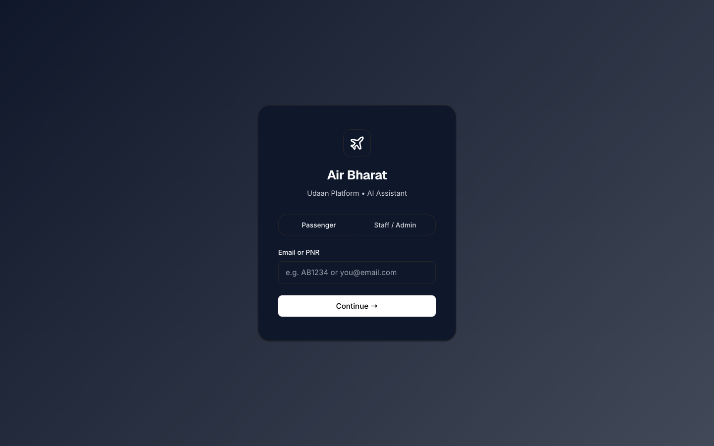

# Air Bharat Udaan - AI-Powered Flight Operations & Passenger Assistant

An enterprise airline customer intelligence and flight operations command portal integrating Retrieval-Augmented Generation (RAG) powered by AWS Bedrock Runtime and Groq LLM inference pipelines.

## System Capabilities

- Multi-Engine LLM Inference: Dynamic integration supporting AWS Bedrock (`@aws-sdk/client-bedrock-runtime`) and ultra-low-latency Groq Cloud API endpoints.
- Retrieval-Augmented Generation: Vector lookup engine querying flight status policies, luggage guidelines, and regulatory documentation from a local structured knowledge base.
- Operational Dashboards: Live flight board monitoring, PNR booking inquiry systems, and visual telemetry charts built with Recharts.
- Responsive Interface: Single-page application built with React 18, Vite, Lucide icons, and modern design tokens.

## Tech Stack

- Frontend: React 18, Vite 5, Tailwind CSS
- Routing: React Router DOM 6
- Data Visualization: Recharts
- AI & LLM SDKs: AWS Bedrock Client SDK, Groq REST integration
- Markdown Parser: React Markdown

## Getting Started

```bash
# Clone the repository
git clone https://github.com/itsyunus/Final-Year-Project.git
cd Final-Year-Project

# Install dependencies
npm install

# Start development server
npm run dev
```

## Live Preview

[Open the deployed Air Bharat project](https://final-year-project-azure-ten.vercel.app).


